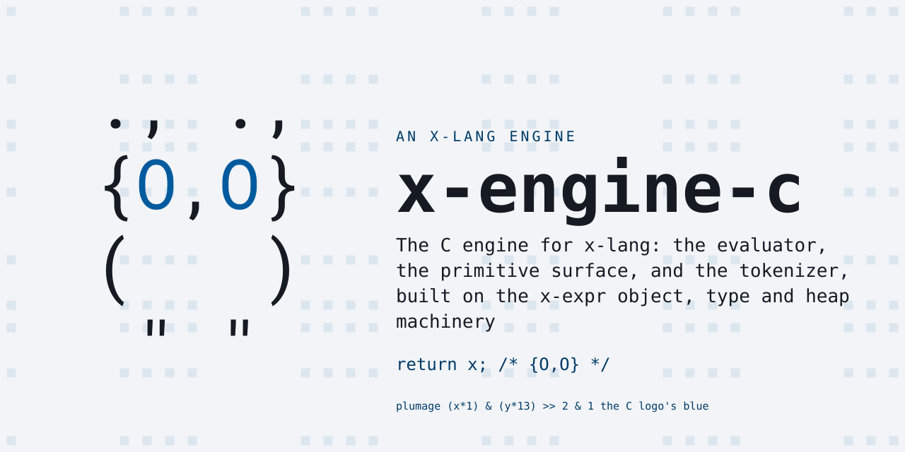
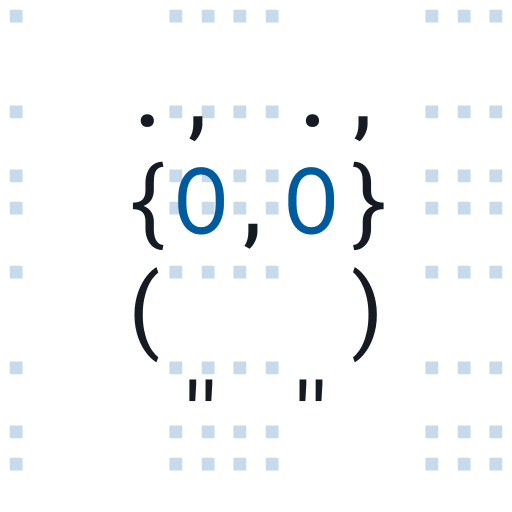

# x-engine-c

The reference engine for [x-lang][x-lang], in C89: the evaluator, the
primitive surface, and the tokenizer, built on the [x-expr][x-expr] object,
type and heap machinery. It is the engine x-lang pins and `make engine`
there fetches. What an engine must provide, promise and report is x-lang's
[engine contract][contract].

This repository builds one artifact, `x-bin`. It has no x-lang printer, no
line editor and no standard library; those are written *in x-lang* and live
in the [x-lang][x-lang] repository. The engine's own loop is bare: it reads
forms from stdin and evaluates each, and the wrapper there puts the library in
front of your source. In its smallest form:

    { cat lib/x-core.x; cat program.x; } | ./x-bin

The engine embeds no x-lang text and generates none. It binds four names
before it reads: `args`, the command line; `x-machine`, the build's target;
`x-version`, the x-expr layer's version; and `x-release`, which release of
the engine this is, so a booted image can say what it was built for.

## Build

    git clone --recursive https://github.com/jonruttan/x-engine-c.git
    cd x-engine-c
    make

`--recursive` matters: [x-expr][x-expr] is a submodule and the build needs its
sources, and the C suite's runner, `tests/c/test-runner`, is another. C89
(`-ansi`).  The engine proper assumes no C library and deals in
no floats: its C library is x-expr's `x-stdlib.h`/`x-sys.h`, and only the CLI
(`src/x-cli.c`) reaches the host -- `syscall`, and `dlopen`/`dlsym` (hence
`-ldl`).  `make check-libc` enforces it.

    make            # build + strip
    make test       # the contract gates + both spec suites
    make gates      # the contract gates alone
    make test-c     # the C spec suite alone
    make test-bare  # the bare-engine smoke specs (no library)
    make test-bare-profile  # the same, and the eval-count specs, on x-bin-profile
    make test-asan  # the C suite under AddressSanitizer
    make help       # every target

Variant builds — `x-bin-debug`, `x-bin-profile`, `x-bin-asan`, `x-bin-cov` —
each compile to their own object suffix, so no two configurations share an
object path and variants rebuild incrementally. `x-bin-profile` also ships in
every release, beside `x-bin`.

## Releases

Each [release](https://github.com/jonruttan/x-engine-c/releases) carries the
engine built for macOS on arm64 and for Linux on x86-64, each a tarball with
its `.sha256`. `make dist` packages one. x-lang names a release and its
digests in `tools/engine/engine.pin.xon`; on any other platform, x-lang's
`make engine-source` builds the pinned release from this source.

## Profiling

`x-bin-profile` is the engine built with `-DX_PROFILE -DX_COV`. A release
strips and signs it as it does `x-bin`, so the two shipped engines differ in
those flags and nothing else. It counts two ways, and reports each `include`'s
load time on stderr.

**The profile counters**: cells in the base object, at the paths
`tools/contract/base-paths.x` gives, for allocations, evals, tail calls, alist,
tree and symbol lookups, the bindings a lookup compares, and collections. A
plain engine counts only evals and tail calls; the rest count only here.

**The eval count**: in every object, how many times evaluation reached it.
Every expression evaluated counts, a tail call included, and so does every
body cell the evaluator steps onto. A procedure's first body cell therefore
holds its calls, and the counts through its body are the evaluation it did
itself. Where coverage marks that a node was reached, the count says how
often. A form's count belongs to its place in the source; a symbol is
interned, so its count is every evaluation of that name, wherever it appears.

The count lives in the object's flags word, bits 11 to 30. Reflective code
reads it with the `tools/contract/obj-layout.x` rows:

    count = (& (>> flags %obj-evals-shift) (- (<< 1 %obj-evals-bits) 1))

It saturates at 1048575 rather than wrapping. Bit 10, `%obj-flag-trace`, stays
free for callers of `heap tree-mark!` and `image write!` to mark with. A build
without `X_PROFILE` never writes these bits, so they read zero there.

## Layout

| path | what |
|---|---|
| `src/x-eval.c` | the evaluator |
| `src/x-env.c` | environments: make, look up, bind, the child a call makes |
| `src/x-tco.c` | the environment save and restore around a tail call |
| `src/x-toplevel.c` | the top-level bracket around a file's forms and `eval!` |
| `src/x-prim/` | the primitive surface (arith, string, io, ffi, heap, …) |
| `src/x-syntax/` | the special forms (binding, closure, control, quote) |
| `src/x-token/` | the s-expression reader |
| `src/x-type/` | the type implementations |
| `src/x-obj/` | object and JIT support |
| `src/x-cli.c` | the command-line entry point |
| `opt/x-prim/signal.c` | optional SIGINT handling (`make X_SIGNAL=` omits it) |
| `include/` | headers, including the generated `x-eval-layout.h` |
| `ext/x-expr/` | the foundation library, as a submodule |
| `tests/c/` | the C spec suite |
| `tests/bare/` | bare-engine smoke specs — the engine with no library on stdin; `profile/` holds the eval-count cases only `x-bin-profile` passes |
| `tools/contract/` | the committed manifests, shipped as the engine's self-description |

## Testing the engine unaided

Every other runner in the project cats a library onto stdin ahead of the test,
so what it measures is the library's surface. For a primitive that is the wrong
subject: reached through `prim-ref`, through a class, or through any name the
library rebinds, it is not the primitive under test. `+` is the plain case — the
primitive is *binary*, and the variadic `+` every ordinary spec exercises is
`lib/x/core/arithmetic.x` sitting on top of it.

`make test-bare` loads nothing. Each case is one engine process fed two lines:
the allocation guard, then the source.

This is **not** the cross-engine conformance suite. That defines what *any*
evaluator must do, so it belongs with the language and lives in
[x-lang][x-lang]; an implementation that owned it would become the arbiter of
the contract every other implementation is judged against.

## The contracts

Gates pin this C surface so it cannot grow or shift silently. Five are
self-contained, run by `make gates`: each scans this repo's C and diffs it
against a committed manifest, with no x-lang checkout in the loop.

| gate | pins | against |
|---|---|---|
| `make check-isa` | every binding site in the C | `tools/contract/isa.x` |
| `make check-obj-layout` | the object header layout | `tools/contract/obj-layout.x` |
| `make check-base-paths` | the base-field accessor chains | `tools/contract/base-paths.x` |
| `make check-base-slots` | the positions in the base's slot vector | `tools/contract/base-slots.x` |
| `make check-libc` | the host boundary | the engine's own sources |

Two more need x-lang beside this repo:

| gate | asks | runs |
|---|---|---|
| `make check-declaration` | whether `x-engine.xon` is what x-lang's generator produces from `isa.x` and `claims.x` | here, with an x-lang checkout |
| `make check-prim-coverage` | whether every primitive is exercised by a spec | in x-lang, over this repo's sources and both suites |

The manifests are also **the engine's published description of itself**.
x-lang's boot loads `base-paths.x` and `obj-layout.x` to learn this engine's
field offsets, reads a slot's position from `base-slots.x`, and its `pin.x`
reads `isa.x` to answer which C surface a tree carries. They ship with the
engine rather than being copied into the library, so a library cannot run on
an engine whose layout disagrees with a copy it holds.

`x-engine.xon` is the engine's declaration: the capabilities it provides,
derived from `isa.x`, and the guarantees it claims, from
`tools/contract/claims.x`. It is generated and not edited.

**The slot vector.** A base holds a vector of function pointers, one per
slot, and the engine reaches a routine by its position
(`include/x-eval-slots.h`). Storing another function in a slot replaces the
routine while the engine runs.

The layout gates each have a **runtime half**, a spec that probes a live
engine. Those need a library to boot, so they run in x-lang under
`tests/x/specs/meta/`.

`check-libc`: the engine reaches libc only through x-expr's
`x_sys_*`/`x_lib_*` doors.  `src/x-cli.c` (the host doors), the optional host
modules under `opt/`, `ctype.h`, `setjmp.h`, the freestanding headers and
DEBUG-only code are exempt.

`tools/contract/base-layout.x` is a pure build input: `make gen-layout` turns
it into `include/x-eval-layout.h`. That header is committed, so a plain
checkout builds without awk. Edit the descriptor, regenerate, then
`make clean && make` — header changes do not trigger object rebuilds on their
own here.

## Adding a primitive

Growing the C surface takes a deliberate manifest edit in the same commit —
that is the point of the ratchet. Register the primitive, run `make check-isa`,
and add the line it reports to `tools/contract/isa.x`. CI here refuses the
commit that skips it.

Then give it a spec: in `tests/c/` if it is reachable from C, or in x-lang's
suite if it is only reachable through the library. `make check-prim-coverage`
in x-lang will fail until one of those exists, or until the primitive carries
a written reason for being deliberately unspecced.

## Documentation

`make doc-c` generates the Doxygen C reference into `docs/ref/c/` (needs
Doxygen). `make install-man` installs its section-3 man pages.

## Licence

MIT No Attribution (MIT-0). See [LICENSE](LICENSE).

[x-lang]: https://github.com/jonruttan/x-lang
[x-expr]: https://github.com/jonruttan/x-expr
[contract]: https://github.com/jonruttan/x-lang/blob/main/docs/engine-contract.md

